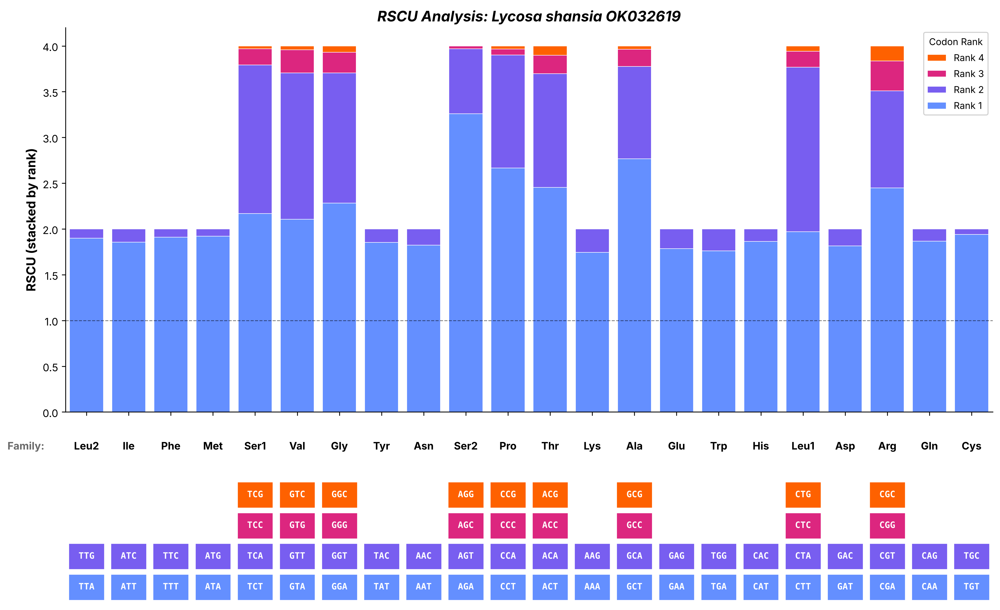

# Relative Synonymous Codon Usage by Specimen

Relative Synonymous Codon Usage (RSCU) values and a stacked-bar RSCU graph for **one specimen** at a time, from that specimen's mitochondrial protein-coding genes, under NCBI Genetic Code 5 (invertebrate mitochondrial).

**Version 1.0.1** (November 2026) · Python 3 (NumPy, pandas, Matplotlib)

## What it does

The program reads one FASTA file holding the protein-coding genes of one specimen, pools the genes, counts codons, and computes RSCU for every sense codon (Sharp et al. 1986; Sharp & Li 1987):

```
RSCU(codon) = count(codon) × n / F
```

where *n* is the number of synonymous codons in the amino-acid family and *F* is the family's total codon count. An RSCU of 1.0 means a codon is used exactly as often as expected if all its synonyms were used equally; above 1.0 it is preferred, below 1.0 avoided.

- **Genetic code:** NCBI Table 5 (Osawa et al. 1992): ATA = Met, AGA/AGG = Ser, TGA = Trp, and only TAA/TAG are stops. Codons are grouped into 22 families, with Leu and Ser each split into two (Leu1 CTN, Leu2 TTR; Ser1 TCN, Ser2 AGN), and RSCU is calculated within each family.
- **Truncated stop codons:** a gene ending in a trailing `T` or `TA` is treated as ending in a stop completed by polyadenylation (Ojala et al. 1981), not as a partial gene.
- **Internal stop codons:** any TAA/TAG before the gene's terminal stop is counted and reported with a console warning naming the gene, because it signals a frameshift, mis-annotation, or sequencing error.
- Stop codons are not part of any family and do not enter RSCU.

There is no comparison between specimens, no statistical test, and no ordination; RSCU here describes one specimen.

## Requirements

| Item | Version or format | Install or notes |
| --- | --- | --- |
| Python | 3.8 or later (developed on 3.13) | Windows 11 + IDLE is the primary environment; Ubuntu/Linux and WSL also work |
| Packages | NumPy, pandas, Matplotlib | `pip install numpy pandas matplotlib` |
| Input | One FASTA file per specimen | One record per protein-coding gene, in frame from the first base (`.fasta`, `.fa`, `.fna`, `.fas`, `.txt`) |

Record headers are read as `>SpecimenID GENE`, for example:

```
>Lycosa_shansia_OK032619 COX1
>Lycosa_shansia_OK032619 COX2
```

The shared first token becomes the specimen name used in output file names and the chart title.

## Quick start

**Windows 11 + IDLE**

1. Put `scripts/rscu_single_specimen_v1_0_1_2026_11_01.py` in the same folder as your specimen FASTA.
2. Open the script in IDLE and press **F5**. If the folder holds one FASTA file it is used automatically; if it holds several, you are asked which one.

**Ubuntu / Linux / WSL**

```
python3 scripts/rscu_single_specimen_v1_0_1_2026_11_01.py --input-file /path/to/specimen.fasta
```

Other options: `--input-dir`, `--specimen-label`, `--output-dir`, `--titles on|off` (off for a publication figure), `--open-chart on|off`. Run with `--help` for details. Each option can also be set in the USER OPTIONS block at the top of the script.

## Outputs

Written to `RSCU_SingleSpecimen_Output_v1.0.1/` next to the input file. Every file name carries the version and version date.

| File | Contents |
| --- | --- |
| `<specimen>_rscu_data_v1.0.1_2026-11-01.csv` | Family, Codon, Count, Family_Total, RSCU |
| `<specimen>_diagnostic_v1.0.1_2026-11-01.csv` | One row per gene: Length_bp, Sense_Codons, Stop_Codons, Internal_Stops, Ambiguous, Truncated_Stop, Partial |
| `<specimen>_summary_v1.0.1_2026-11-01.csv` | Specimen totals: genes, bp, sense codons, ambiguous codons, truncated stops, internal stops, partial genes |
| `<specimen>_rscu_chart_v1.0.1_2026-11-01.png` | Stacked-bar RSCU graph, 300 dpi |

A clean run on a good-quality mitogenome shows zero ambiguous codons, zero internal stops, zero partial genes, and a few truncated stops. As a check, the RSCU values in each family sum to the number of synonymous codons in that family (4.0 for Ala, 2.0 for Phe).

## Worked example

The `example/` folder holds a ready-to-run input file and the output it produces, so you can check that your installation gives the same result.

**Input:** [`example/Lycosa_shansia_OK032619.fasta`](example/Lycosa_shansia_OK032619.fasta), the 13 mitochondrial protein-coding genes of the wolf spider *Lycosa shansia*, taken from the published complete mitogenome GenBank [OK032619](https://www.ncbi.nlm.nih.gov/nuccore/OK032619) (Ye et al. 2022). Each record has a header in the form `>Lycosa_shansia_OK032619 GENE`.

**Command:**

```
python3 scripts/rscu_single_specimen_v1_0_1_2026_11_01.py --input-file example/Lycosa_shansia_OK032619.fasta
```

**Console summary:**

```
  Specimen:   Lycosa_shansia_OK032619
  Genes read: 13 (COX1, COX2, ATP8, ATP6, COX3, ND3, ND5, ND4, ND4L, ND6, CytB, ND1, ND2)

  Genes pooled     : 13
  Total bp         : 10806
  Sense codons     : 3590
  Ambiguous codons : 0
  Truncated stops  : 2  (poly-A-completed; Ojala et al. 1981)
  Internal stops   : 0
  Partial genes    : 0
```

**Output files** (in [`example/RSCU_SingleSpecimen_Output_v1.0.1/`](example/RSCU_SingleSpecimen_Output_v1.0.1/)):

- [`Lycosa_shansia_OK032619_rscu_data_v1.0.1_2026-11-01.csv`](example/RSCU_SingleSpecimen_Output_v1.0.1/Lycosa_shansia_OK032619_rscu_data_v1.0.1_2026-11-01.csv)
- [`Lycosa_shansia_OK032619_diagnostic_v1.0.1_2026-11-01.csv`](example/RSCU_SingleSpecimen_Output_v1.0.1/Lycosa_shansia_OK032619_diagnostic_v1.0.1_2026-11-01.csv)
- [`Lycosa_shansia_OK032619_summary_v1.0.1_2026-11-01.csv`](example/RSCU_SingleSpecimen_Output_v1.0.1/Lycosa_shansia_OK032619_summary_v1.0.1_2026-11-01.csv)
- [`Lycosa_shansia_OK032619_rscu_chart_v1.0.1_2026-11-01.png`](example/RSCU_SingleSpecimen_Output_v1.0.1/Lycosa_shansia_OK032619_rscu_chart_v1.0.1_2026-11-01.png)

### RSCU graph



Each bar is one amino-acid family, ordered from most to least used. Within a bar, codons are stacked by rank, with the most-used codon (Rank 1) at the bottom; the key below the bars names the codon in each segment. The dashed line marks RSCU = 1.0. Codons that were never used still appear in the key: AGG (Ser2) has a count of 0.

### Diagnostic table

| Gene | Length_bp | Sense_Codons | Stop_Codons | Internal_Stops | Ambiguous | Truncated_Stop | Partial |
| --- | --- | --- | --- | --- | --- | --- | --- |
| COX1 | 1539 | 512 | 1 | 0 | 0 | False | False |
| COX2 | 666 | 221 | 1 | 0 | 0 | False | False |
| ATP8 | 156 | 51 | 1 | 0 | 0 | False | False |
| ATP6 | 666 | 221 | 1 | 0 | 0 | False | False |
| COX3 | 786 | 261 | 1 | 0 | 0 | False | False |
| ND3 | 357 | 118 | 1 | 0 | 0 | False | False |
| ND5 | 1641 | 546 | 1 | 0 | 0 | False | False |
| ND4 | 1280 | 426 | 1 | 0 | 0 | True | False |
| ND4L | 268 | 89 | 1 | 0 | 0 | True | False |
| ND6 | 432 | 143 | 1 | 0 | 0 | False | False |
| CytB | 1137 | 378 | 1 | 0 | 0 | False | False |
| ND1 | 915 | 304 | 1 | 0 | 0 | False | False |
| ND2 | 963 | 320 | 1 | 0 | 0 | False | False |

Every gene has one stop codon and no internal stops. ND4 and ND4L end in truncated stops (`TA` and `T`), which is typical of spider mitochondrial genes.

### RSCU values

| Family | Codons | Total | Codon: count (RSCU) |
| --- | --- | --- | --- |
| Ala | 4 | 107 | GCT: 74 (2.77), GCC: 5 (0.19), GCA: 27 (1.01), GCG: 1 (0.04) |
| Arg | 4 | 49 | CGT: 13 (1.06), CGC: 2 (0.16), CGA: 30 (2.45), CGG: 4 (0.33) |
| Asn | 2 | 159 | AAT: 145 (1.82), AAC: 14 (0.18) |
| Asp | 2 | 65 | GAT: 59 (1.82), GAC: 6 (0.18) |
| Cys | 2 | 34 | TGT: 33 (1.94), TGC: 1 (0.06) |
| Gln | 2 | 45 | CAA: 42 (1.87), CAG: 3 (0.13) |
| Glu | 2 | 84 | GAA: 75 (1.79), GAG: 9 (0.21) |
| Gly | 4 | 177 | GGT: 63 (1.42), GGC: 3 (0.07), GGA: 101 (2.28), GGG: 10 (0.23) |
| His | 2 | 73 | CAT: 68 (1.86), CAC: 5 (0.14) |
| Ile | 2 | 392 | ATT: 364 (1.86), ATC: 28 (0.14) |
| Leu1 | 4 | 69 | CTT: 34 (1.97), CTC: 3 (0.17), CTA: 31 (1.80), CTG: 1 (0.06) |
| Leu2 | 2 | 434 | TTA: 412 (1.90), TTG: 22 (0.10) |
| Lys | 2 | 117 | AAA: 102 (1.74), AAG: 15 (0.26) |
| Met | 2 | 361 | ATA: 347 (1.92), ATG: 14 (0.08) |
| Phe | 2 | 374 | TTT: 357 (1.91), TTC: 17 (0.09) |
| Pro | 4 | 120 | CCT: 80 (2.67), CCC: 2 (0.07), CCA: 37 (1.23), CCG: 1 (0.03) |
| Ser1 | 4 | 249 | TCT: 135 (2.17), TCC: 11 (0.18), TCA: 101 (1.62), TCG: 2 (0.03) |
| Ser2 | 4 | 124 | AGT: 22 (0.71), AGC: 1 (0.03), AGA: 101 (3.26), AGG: 0 (0.00) |
| Thr | 4 | 119 | ACT: 73 (2.45), ACC: 6 (0.20), ACA: 37 (1.24), ACG: 3 (0.10) |
| Trp | 2 | 84 | TGA: 74 (1.76), TGG: 10 (0.24) |
| Tyr | 2 | 164 | TAT: 152 (1.85), TAC: 12 (0.15) |
| Val | 4 | 190 | GTT: 76 (1.60), GTC: 2 (0.04), GTA: 100 (2.11), GTG: 12 (0.25) |

RSCU values are rounded to two decimals here; the CSV gives four. The family totals sum to the 3,590 sense codons, and within each family the RSCU values sum to the number of codons in that family (allowing for rounding).

## Documentation

- [`docs/README_rscu_single_specimen_v1_0_1_2026_11_01.txt`](docs/README_rscu_single_specimen_v1_0_1_2026_11_01.txt): full reference, including run environments, caveats, method detail, output descriptions, the worked example, and references with DOIs.
- [`CHANGELOG.md`](CHANGELOG.md): changes between versions.

## References

- Ojala D, Montoya J, Attardi G. 1981. tRNA punctuation model of RNA processing in human mitochondria. *Nature* 290:470–474. [doi:10.1038/290470a0](https://doi.org/10.1038/290470a0)
- Osawa S, Jukes TH, Watanabe K, Muto A. 1992. Recent evidence for evolution of the genetic code. *Microbiological Reviews* 56:229–264. [doi:10.1128/mr.56.1.229-264.1992](https://doi.org/10.1128/mr.56.1.229-264.1992)
- Sharp PM, Li W-H. 1987. The codon adaptation index — a measure of directional synonymous codon usage bias, and its potential applications. *Nucleic Acids Research* 15:1281–1295. [doi:10.1093/nar/15.3.1281](https://doi.org/10.1093/nar/15.3.1281)
- Sharp PM, Tuohy TMF, Mosurski KR. 1986. Codon usage in yeast: cluster analysis clearly differentiates highly and lowly expressed genes. *Nucleic Acids Research* 14:5125–5143. [doi:10.1093/nar/14.13.5125](https://doi.org/10.1093/nar/14.13.5125)
- Ye W, Wang J, Zhao X, Liu H, Zhu S. 2022. Mitochondrial genomes of two *Lycosa* spiders (Araneae, Lycosidae): genome description and phylogenetic implications. *Diversity* 14:538. [doi:10.3390/d14070538](https://doi.org/10.3390/d14070538) (example data, GenBank OK032619)

Software: NumPy (Harris et al. 2020), pandas (McKinney 2010), Matplotlib (Hunter 2007); full citations are in the documentation.
